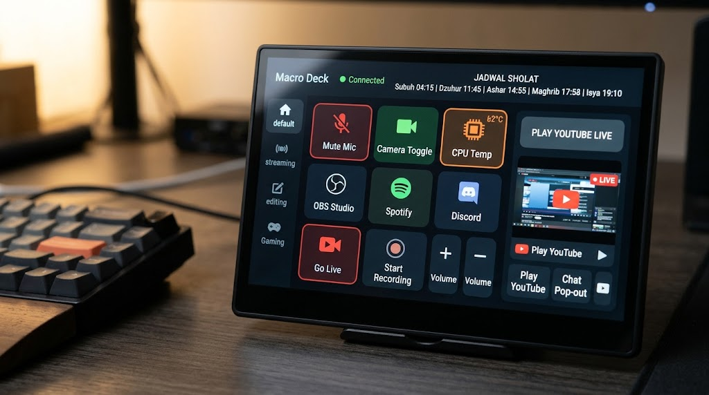

# Macro Deck 7 Inch - Portable Touch Console (PyQt6)

Aplikasi Macro Deck khusus layar sentuh 7 inci (resolusi 1024x600) berbasis Python & PyQt6 dengan desain Dark Futuristic. Dilengkapi jadwal sholat otomatis, pemantau CPU, kontrol volume, pintasan aplikasi streaming/editing, YouTube Live stream widget, dan konfigurasi eksternal `config.ini`.



---

## ⚡ Fitur Utama
1. **Dua Mode Eksekusi:**
   - 🌐 **Mode Web App Lokal (SANGAT DIREKOMENDASIKAN UNTUK LAPTOP KANTOR):** Berjalan di `http://localhost:5000` via Chrome/Edge App Mode 1024x600. **100% Bebas Blokir Microsoft Defender SmartScreen**, tanpa perlu compile .exe, tanpa hak admin!
   - 💻 **Mode Desktop Standalone (PyQt6 .exe):** Aplikasi native frameless dengan build kit PyInstaller.
2. **Resolusi Terkunci 1024x600 (Touch Optimized):** Sesuai standar monitor LCD HDMI 7 inci (Raspberry Pi/PC secondary display). Mode frameless dan fullscreen (`F11`).
2. **Header Informatif:** 
   - Status `🟢 Connected`
   - Jam digital real-time
   - **Jadwal Sholat Otomatis:** Terhubung ke API Aladhan (Subuh, Dzuhur, Ashar, Maghrib, Isya) dengan fallback offline otomatis agar tidak pernah crash.
3. **Sidebar Kategori Touch-Friendly:**
   - 🏠 **Default:** Mute Mic, Camera Toggle, CPU Temp/Usage, OBS, Spotify, Discord, Go Live, Recording, Volume Control.
   - 📡 **Stream:** Scene Switcher, Chat Overlay, Soundboard, Replay Buffer.
   - ✂️ **Edit:** Razor tool, Ripple delete, Marker, Render, Audio Normalization, Export.
   - 🎮 **Gaming:** Game Bar, Screenshot, Discord Deafen, EQ Bass Boost, Speedrun Timer.
4. **YouTube Live Player:** Widget pemutar live stream langsung (`QWebEngineView`) + tombol Pop-out Chat.
5. **Konfigurasi Eksternal `config.ini`:** Mengubah kota sholat, hotkey, path aplikasi, URL live stream tanpa perlu menyusun ulang kode.
6. **Logging Terintegrasi:** Log otomatis ke `macro_deck.log` untuk kemudahan debugging.

---

## 🚀 Panduan di GitHub Codespaces

### 1. Instalasi Dependensi
Jalankan di Terminal Codespaces:
```bash
pip install -r requirements.txt
```

### 2. Menjalankan Aplikasi di Codespaces (Uji Coba GUI)
Karena Codespaces berjalan di container cloud berbasis Linux tanpa monitor fisik langsung, instal virtual frame buffer:
```bash
sudo apt-get update && sudo apt-get install -y xvfb libxkbcommon-x11-0 libgl1-mesa-glx
xvfb-run -s "-screen 0 1024x600x24" python main.py
```
*Tips:* Anda juga dapat menggunakan ekstensi VS Code **"VNC"** atau **"Desktop Lite"** di Codespaces jika ingin melihat jendela GUI interaktif di browser.

---

## 📦 Cara Mem-build Menjadi File Portable (.exe)

### Opsi A: Otomatis via GitHub Actions (Rekomendasi Terbaik untuk Codespaces)
Repository ini sudah dilengkapi workflow `.github/workflows/build-exe.yml`.
1. Commit & Push kode ke repository GitHub Anda:
   ```bash
   git add .
   git commit -m "Build Windows EXE"
   git push origin main
   ```
2. Buka tab **Actions** di repository GitHub Anda.
3. Workflow `Build Windows Portable EXE` akan berjalan secara otomatis di server Windows runner resmi GitHub.
4. Setelah selesai (± 2 menit), download file `MacroDeck7Inch_Portable.exe` langsung di bagian **Artifacts**!

---

### Opsi B: Build Langsung di Laptop / PC Windows
1. Pastikan Python 3.10+ sudah terinstal di Windows.
2. Buka Command Prompt / PowerShell di folder proyek.
3. Jalankan script otomatis:
   ```cmd
   build_exe.bat
   ```
   Atau jalankan perintah manual:
   ```cmd
   pip install -r requirements.txt
   pyinstaller --noconfirm --onefile --windowed --name "MacroDeck7Inch_Portable" --add-data "config.ini;." --hidden-import "PyQt6.QtWebEngineWidgets" --hidden-import "PyQt6.QtWebEngineCore" --hidden-import "psutil" --hidden-import "requests" main.py
   ```
4. File `.exe` siap pakai akan berada di dalam folder `dist/MacroDeck7Inch_Portable.exe`.
